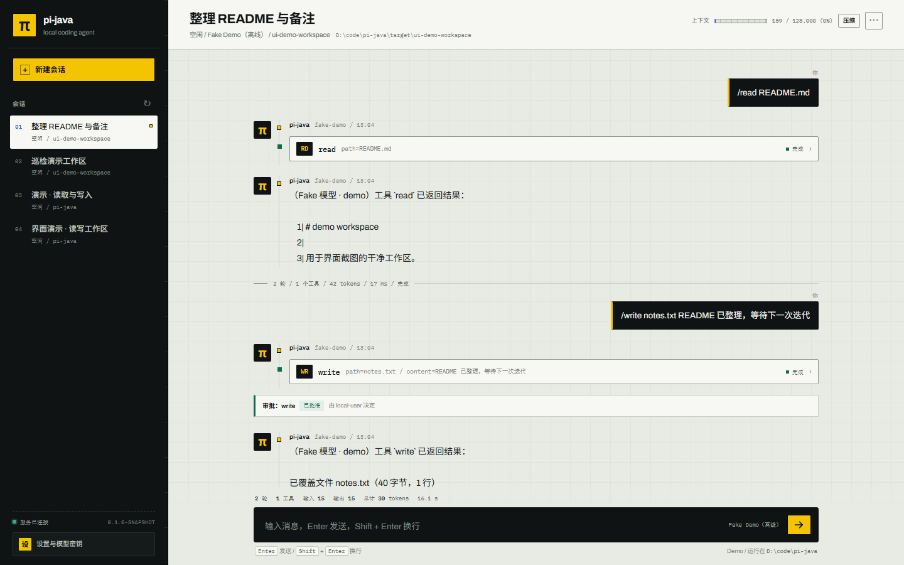
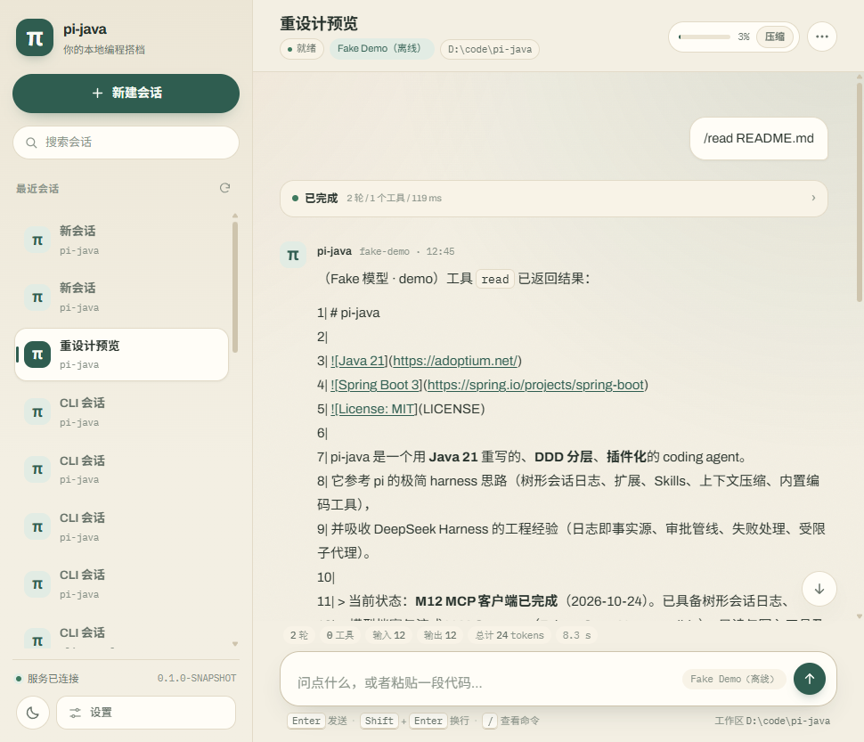
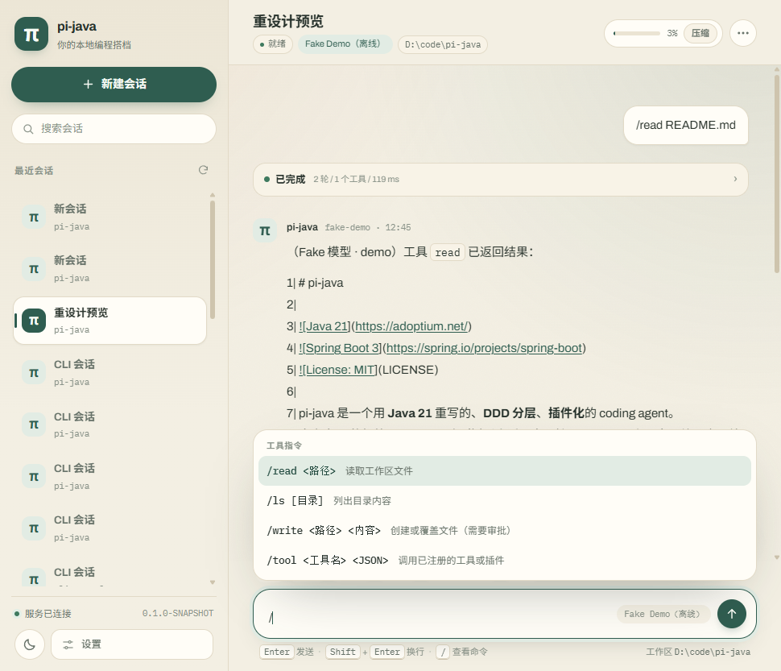
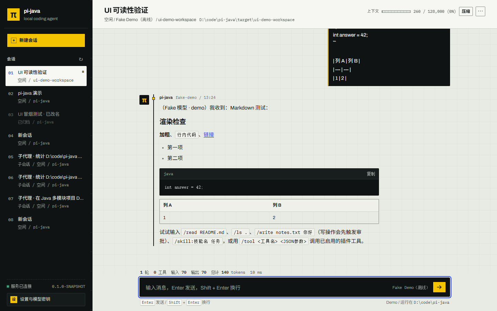
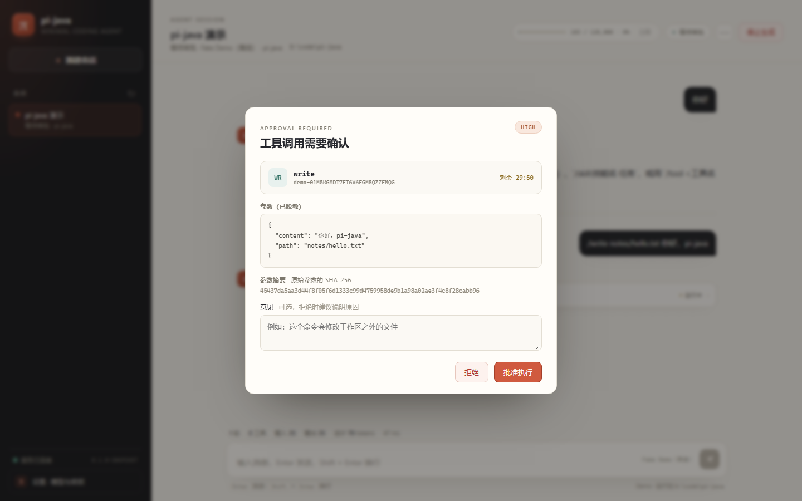
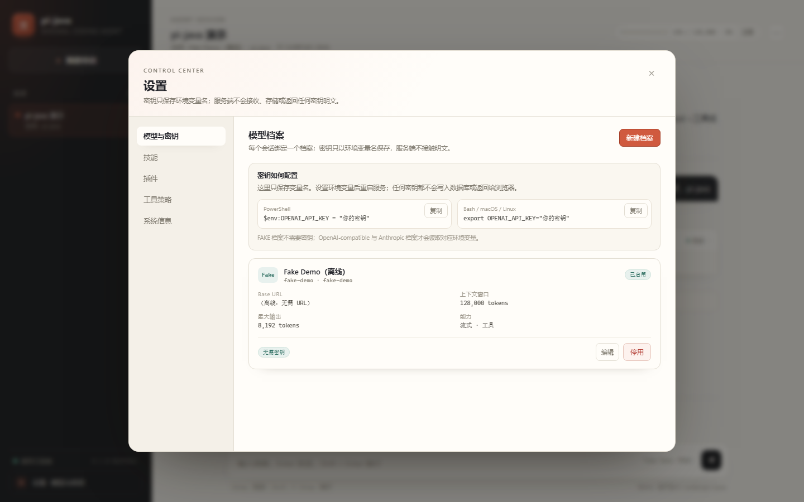

# pi-java

[](https://adoptium.net/)
[](https://spring.io/projects/spring-boot)
[](LICENSE)

pi-java 是一个用 **Java 21** 重写的、**DDD 分层**、**插件化**的 coding agent。
它参考 pi 的极简 harness 思路（树形会话日志、扩展、Skills、上下文压缩、内置编码工具），
并吸收 DeepSeek Harness 的工程经验（日志即事实源、审批管线、失败处理、受限子代理）。

> 当前状态：**M12 MCP 客户端已完成**（2026-10-24）。已具备树形会话日志、
> 模型档案与流式 LLM Gateway（Fake + OpenAI-compatible）、只读与写入工具及路径沙箱、
> Agent Loop、SSE 事件重放、Web UI 设置中心、审批状态机、结构化上下文压缩、
> 文件系统 Skills、同步子代理，以及会话设置与上下文用量仪表。
> Web UI 采用“信号工作台”视觉：纸面、墨黑结构、信号黄主操作与钴蓝焦点，字体本地化离线可用。
> 对话区默认折叠思考与工具过程，支持斜杠命令提示与安全 Markdown 渲染，字号与对比度按可读性调整。
> 同一个 jar 既是 Web 服务也是 CLI：`pi run`、`pi chat`、`pi sessions/models/tools`、
> `pi serve` 共用同一 Spring 容器、数据库、插件与审批管线。
> v0.2 从 M12 开始：已接入 MCP（stdio/Streamable HTTP）动态工具，
> 下一步是 Git 检查点、计划与自动验证。



<details>
<summary>更多截图：过程折叠、斜杠命令、Markdown、审批弹窗与设置</summary>











</details>

## 快速体验

推荐用脚本启动（自动探测 JDK 21、检查 Key、注册模型档案）：

```powershell
$env:PI_DEEPSEEK_KEY = "sk-你的key"   # 可选；不设则只能用 Fake 离线模型
.\scripts\start.ps1
```

也可以手动启动：

```bash
mvn -q -DskipTests package
java -jar pi-java-app/target/pi-java-app-0.1.0-SNAPSHOT.jar
```

打开 <http://127.0.0.1:8080>，新建会话后输入 `/read README.md`、`/ls .` 或
`/write notes.txt 你好`。写工具会弹出审批框，批准后才真正落盘；也可以在弹窗中拒绝。
右上角齿轮进入设置中心，可管理模型档案与密钥环境变量、技能、插件、工具策略；
顶栏仪表显示上下文用量，空闲时可手动压缩。默认 demo profile 使用 H2 文件库与 Fake LLM，
**不需要任何 API Key**。服务只监听 `127.0.0.1`，v0.1 无鉴权，禁止直接暴露公网。

接入真实模型、技能配置与常见问题见 [快速上手](docs/09-quick-start.md)。

### CLI

同一个 jar 既启动 Web，也提供命令行入口；不带参数仍是 Web 服务。

```bash
JAR=pi-java-app/target/pi-java-app-0.1.0-SNAPSHOT.jar

java -jar $JAR run "读取 pom.xml 并总结依赖" --cwd D:/code/demo
java -jar $JAR run "跑一遍测试并总结失败" --json --timeout 900
java -jar $JAR chat --cwd D:/code/demo
java -jar $JAR chat --session <sessionId>
java -jar $JAR sessions list --cwd D:/code/demo
java -jar $JAR sessions show <sessionId>
java -jar $JAR models list
java -jar $JAR tools list
java -jar $JAR serve --port 8081
```

- `run` 默认流式打印文本、思考与工具轨迹；`--json` 时 stdout 只有一个 JSON 对象，
  提示信息走 stderr。退出码：`0` 成功、`1` 失败/超时、`2` 参数错误、
  `3` 审批被拒绝、`4` 取消。
- 写工具审批在终端询问 `y/N`；没有输入（EOF）按拒绝处理；`--approve` 自动批准本次
  run 的全部审批，仅建议在可信工作区使用。
- `chat` 在真实终端里是方框输入区的交互界面：彩色流式输出、输入 `/` 列出可用命令、
  `Tab` 补全、`↑/↓` 翻历史；`Ctrl+C` 运行中取消任务，空闲时连按两次退出，
  `Ctrl+D` 随时退出。管道或脚本里自动退回逐行模式，`--plain` 可强制逐行。
- `chat` 支持 `/help`、`/exit`、`/abort`、`/compact`、`/model`、`/tree`、
  `/session` 与 `/skill:名称`；逐行模式下运行期间输入 `/abort` 可取消当前任务。
- CLI 与 Web 使用同一数据库、同一套用例与同一条审批管线；CLI 不直接操作 Mapper。

上下文压缩与技能（M7）：

```bash
# 查看技能目录（默认读取 ~/.pi-java/skills，可用 pi.agent.skills 覆盖）
curl http://127.0.0.1:8080/api/v1/skills

# 手动压缩空闲会话；内容不足时返回 applied=false 并说明原因
curl -X POST http://127.0.0.1:8080/api/v1/sessions/<sessionId>/compact

# 在对话中使用技能：正文会被展开后发送并落库
/skill:deploy 发布 1.2.0
```

技能目录结构：`skills/<name>/SKILL.md`，可选 frontmatter：

```markdown
---
name: deploy
description: 打包与发布流程
---
第一步：执行 mvn -q package
```

体验插件（另开终端）：

```bash
mvn -q -pl examples/pi-plugin-example -am package

curl -X POST http://127.0.0.1:8080/api/v1/plugins \
  -H 'Content-Type: application/json' \
  -d '{"jarPath":"D:/code/pi-java/examples/pi-plugin-example/target/pi-plugin-example-0.1.0-SNAPSHOT.jar"}'
curl -X POST http://127.0.0.1:8080/api/v1/plugins/com.piagent.example.hello/enable
```

然后在会话输入 `/tool com.piagent.example.hello.greet {"name":"pi"}`。
完整步骤见 [示例插件说明](examples/pi-plugin-example/README.md)。

## 核心设计

- **会话日志是唯一事实源**：消息、压缩摘要、审批决策、运行摘要都是 append-only entry，
  分支只移动 leaf，不复制历史。
- **领域纯净**：`domain` 只依赖 JDK；Spring、Jackson、MyBatis、插件加载都在外层。
- **安全默认**：只读工具放行；`write/edit` 默认询问并阻塞等待人工审批，批准后才执行；
  `bash` 默认拒绝，需要显式策略放行；路径沙箱对所有文件工具生效。
- **插件化**：零依赖 `plugin-api`，每个插件独立 ClassLoader，工具带插件前缀。
- **MCP 动态工具**：配置 `pi.mcp.servers` 即可接入 stdio 或 Streamable HTTP 服务器，
  工具自动带 `<server>.` 前缀进入目录、策略与审批管线；超时/断线转为工具错误，
  不打断 run。
- **子代理受限**：`subagent` 工具同步委派子任务；工具子集只能收紧、深度有上限、
  失败/超时都以结构化结果回写，父循环不中断。
- **上下文有界**：接近窗口时结构化压缩（目标/约束/进展/决策/下一步/关键上下文），
  不收敛时降级为只剪枝，绝不进入无限压缩。
- **技能按需加载**：只把名称与描述放进 system prompt，正文由模型 `read` 或
  `/skill:name` 注入，避免每次请求都携带全部知识。
- **单机强一致**：一个 session 同时只有一个活跃 run；不引入 Redis。
- **可测试**：Fake LLM、Fake 时钟、H2、WireMock，离线可跑完整链路。

## 模块

| 模块 | 职责 |
|---|---|
| `pi-java-domain` | 纯领域：7 个限界上下文、聚合、值对象、领域服务、仓储/端口 |
| `pi-java-application` | 用例编排、Agent Loop、事务边界、读模型 |
| `pi-java-plugin-api` | 零依赖的第三方插件契约 |
| `pi-java-infrastructure` | LLM 接入、MyBatis 仓储、内置工具、插件加载、MCP 客户端、缓存 |
| `pi-java-trigger` | HTTP/SSE 接口与 picocli CLI 命令 |
| `pi-java-app` | Spring Boot 装配、Flyway、Web UI、架构测试 |
| `examples/pi-plugin-example` | 示例插件，验证契约纯度 |

依赖方向：`app -> trigger/infrastructure`，`trigger -> application`，
`infrastructure -> application/domain/plugin-api`，`application -> domain`。

## 构建

需要 JDK 21 与 Maven 3.9+。

```bash
mvn -q verify
```

当前 M12 已验证通过：`mvn -q verify`（含 repackage）全绿，671 个测试
（2 个符号链接用例条件跳过），Checkstyle/ArchUnit 与覆盖率门槛通过。
打包前需停止正在运行的实例（Windows 会锁住 jar），调试时可只跑测试并加
`-Dspring-boot.repackage.skip=true`——该模式产出的 jar 不可直接 `java -jar`。

## 文档

完整文档见 [docs/README.md](docs/README.md)。

- [愿景与范围](docs/00-vision-and-scope.md)
- [整体架构](docs/01-architecture.md)
- [领域模型](docs/02-domain-model.md)
- [数据库设计（6 张表完整 DDL）](docs/03-database-design.md)
- [运行时与事件](docs/04-runtime-and-events.md)
- [API 与 CLI](docs/05-api-and-cli.md)
- [插件 SDK](docs/06-plugin-sdk.md)
- [测试与质量](docs/07-testing-and-quality.md)
- [路线图](docs/08-roadmap.md)
- [快速上手](docs/09-quick-start.md)
- [MCP 客户端](docs/10-mcp.md)
- [M0 里程碑记录](docs/milestones/M0.md)
- [M1 里程碑记录](docs/milestones/M1.md)
- [M2 里程碑记录](docs/milestones/M2.md)
- [M3 里程碑记录](docs/milestones/M3.md)
- [M4 里程碑记录](docs/milestones/M4.md)
- [M5 里程碑记录](docs/milestones/M5.md)
- [M6 里程碑记录](docs/milestones/M6.md)
- [M7 里程碑记录](docs/milestones/M7.md)
- [M8 里程碑记录](docs/milestones/M8.md)
- [M9 里程碑记录（Web UI 与开源准备）](docs/milestones/M9.md)
- [M10 里程碑记录（界面重构 · 信号工作台）](docs/milestones/M10.md)
- [M11 里程碑记录（CLI 与 v0.1.0 收尾）](docs/milestones/M11.md)
- [M12 里程碑记录（MCP 客户端）](docs/milestones/M12.md)

架构决策：

- [ADR 0001：会话日志是唯一事实源](docs/adr/0001-session-log-as-source-of-truth.md)
- [ADR 0002：不引入 Redis，只使用本地 Caffeine](docs/adr/0002-no-redis-local-cache.md)
- [ADR 0003：插件 API 零依赖](docs/adr/0003-plugin-api-zero-dependency.md)
- [ADR 0004：手写 LLM Gateway](docs/adr/0004-hand-rolled-llm-gateway.md)

## 安全

- v0.1 默认只监听 `127.0.0.1`，无鉴权，禁止直接暴露公网；
- 模型密钥只从环境变量读取，数据库只保存环境变量名；
- 插件类加载隔离不是安全沙箱，只安装可信来源；
- MCP 工具由外部服务器执行，路径沙箱不覆盖其内部行为；token 只写 `${ENV_VAR}`。
- `bash` 无法做路径级沙箱，只能限制 cwd、审批、超时与输出，文档与 UI 会明确提示。

## 开发约定

- 主代码文件 ≤ 300 行，方法 ≤ 50 行，参数 ≤ 6；一个文件一个顶层类型；
- public 类型必须有中文 Javadoc，核心算法解释“为什么”与不变量；
- 每个里程碑：实现 → 测试 → 实际运行 → 更新文档 → 单独提交；
- 不主动 push，发布 tag 需明确确认。
