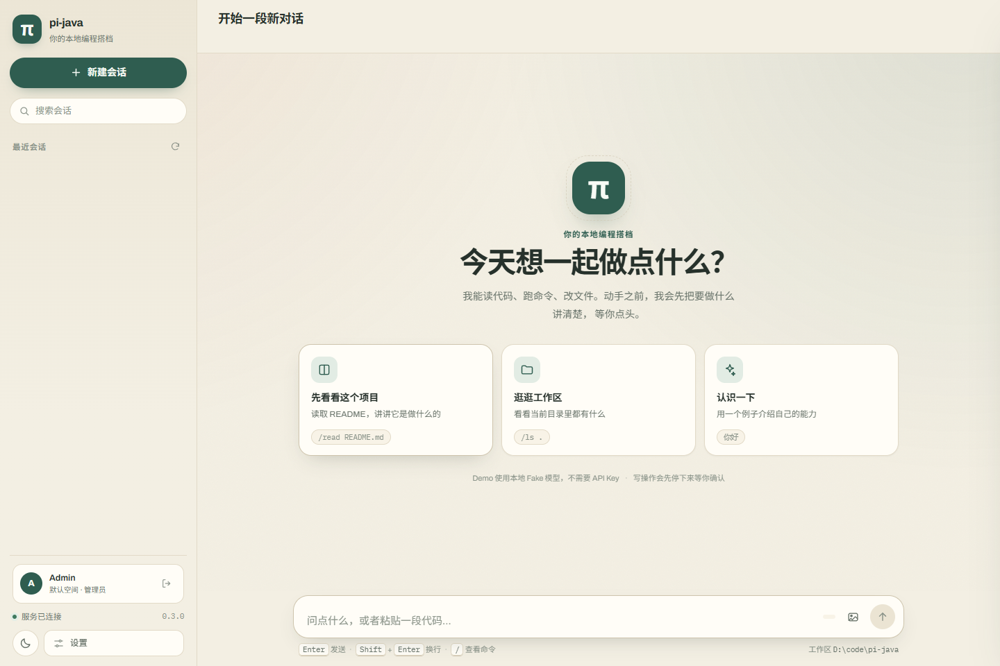
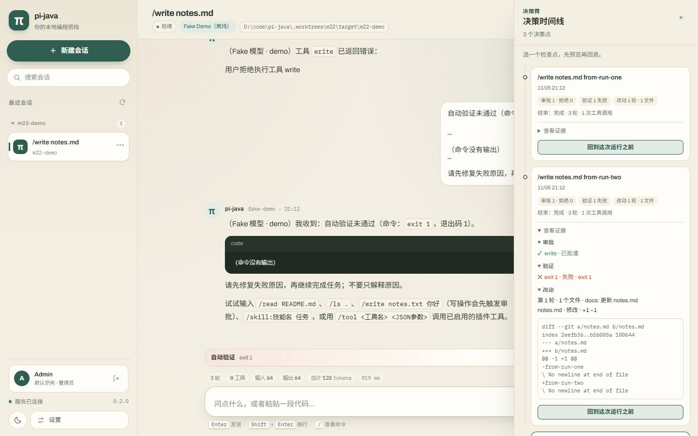
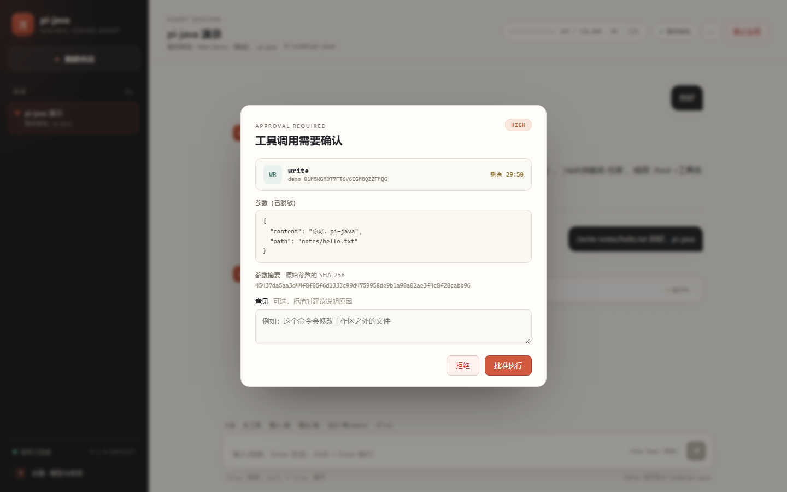
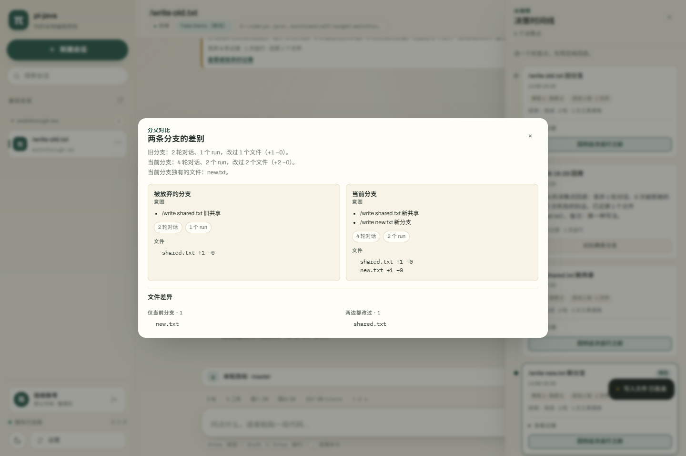
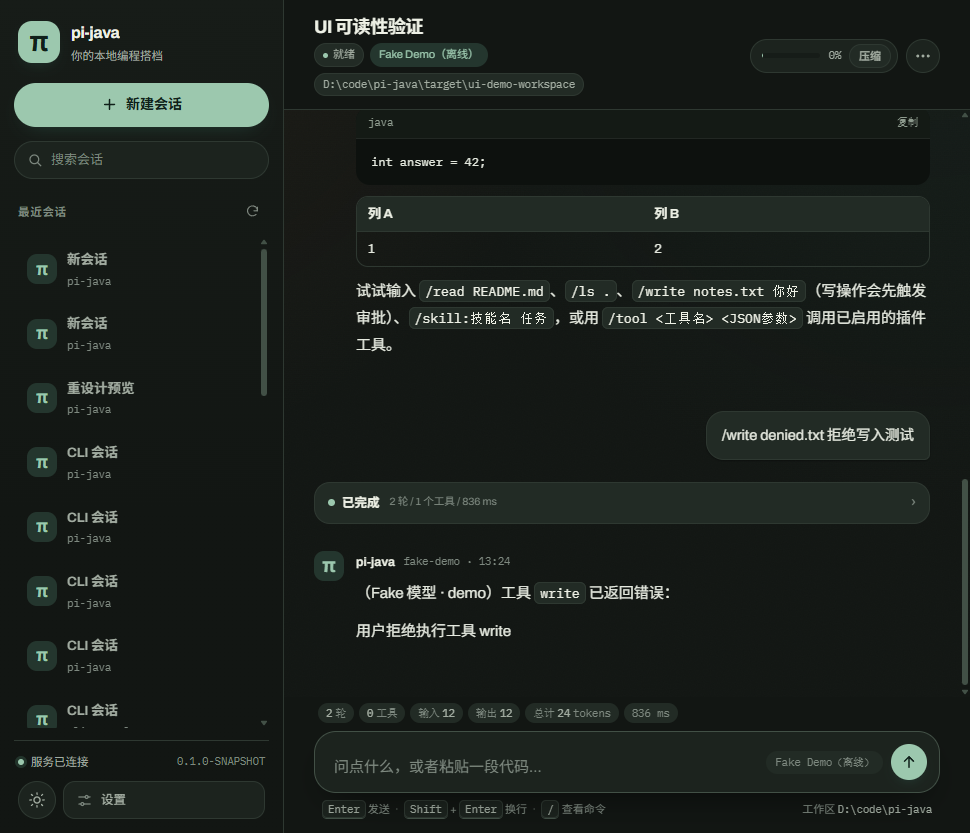
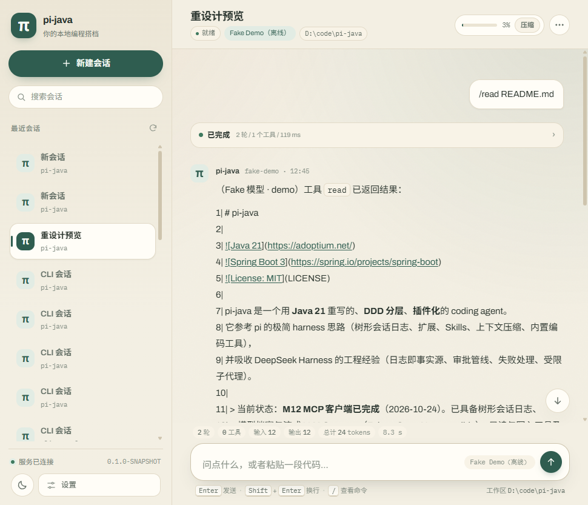
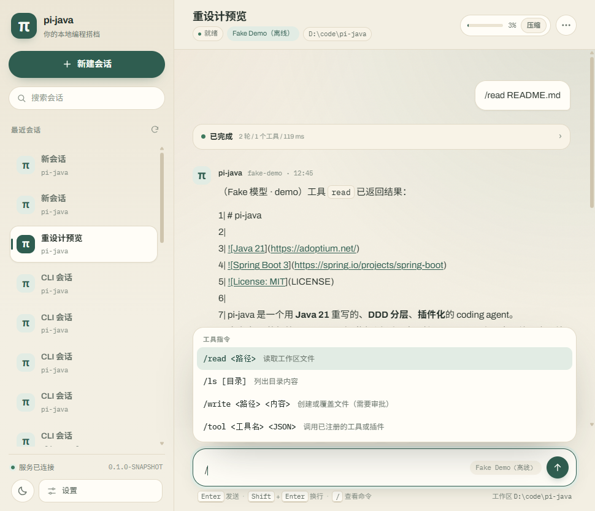
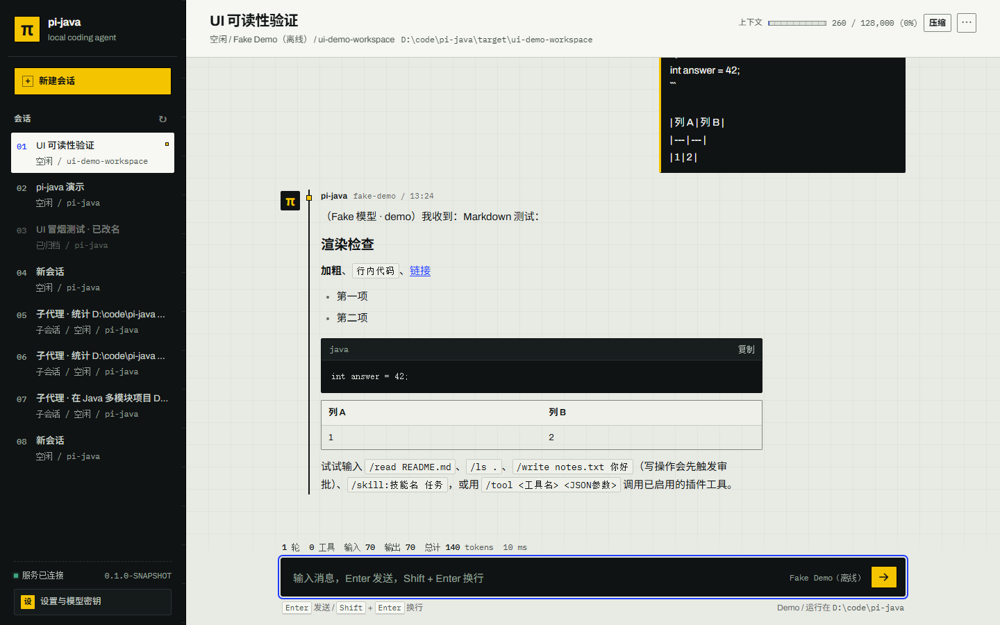
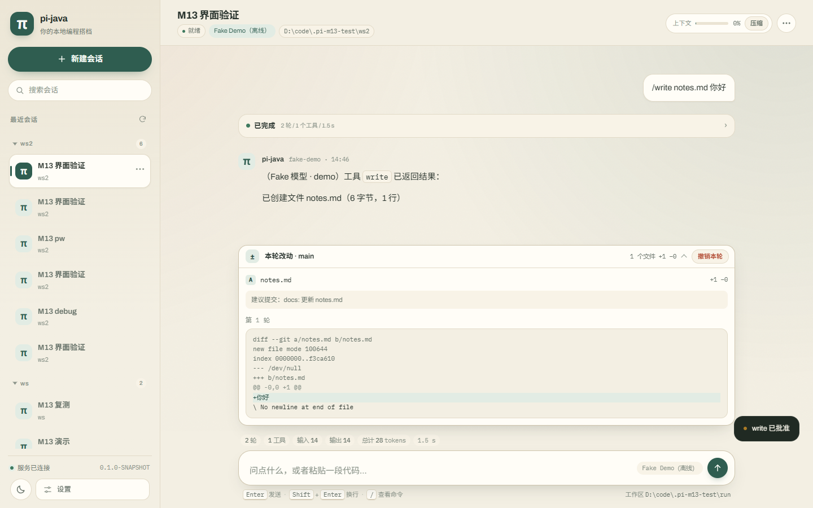
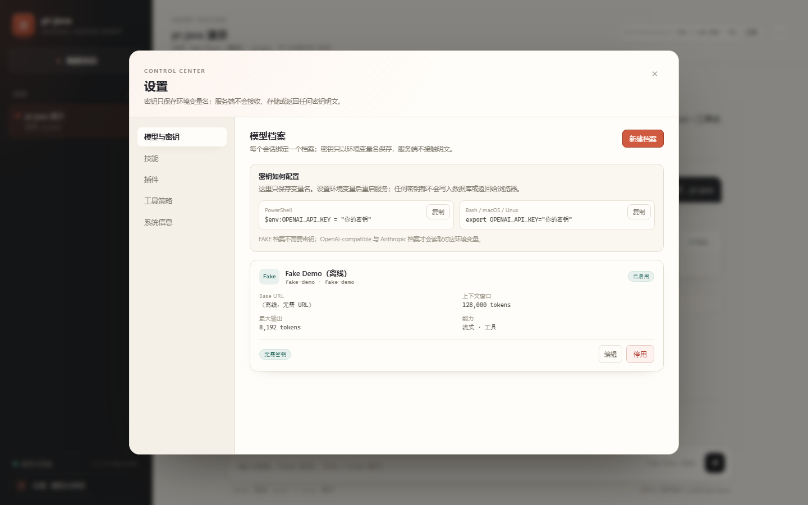

# pi-java

**一个会留下决策记录的 Java coding agent。** 每一步的意图、审批、验证和改动都能回看；
走错了可以退回任意检查点，被放弃的那条路也能拿出来对比。

[](https://github.com/Algorithm-zh/pi-java/actions/workflows/ci.yml)
[](https://adoptium.net/)
[](https://spring.io/projects/spring-boot)
[](LICENSE)

pi-java 用 **Java 21 + DDD 分层 + 插件化** 实现，提供一个 jar、两种入口：
浏览器里的 Web 工作台和终端里的 `pi` CLI。数据、工具、审批、插件全部跑在本机，
离线 Fake 模型不需要任何 API Key 就能完整体验。

> **当前版本 v0.3.0**（2026-11-06 发布）。`main` 已合入 M24 去账号化：
> 删除账号、令牌与空间体系，恢复为单用户本地服务，打开页面即可使用。
> 948 个测试通过，Checkstyle / ArchUnit / OpenAPI 校验全绿。



## 为什么是 pi-java

大多数 coding agent 只给你一个结果。pi-java 更关心**结果是怎么来的**：

| | |
|---|---|
| **决策可见** | 每次运行的意图、计划、审批、验证和逐轮 diff 都在时间线上，不用翻日志猜。 |
| **可以反悔** | 预览并回到任意一次运行之前，对话和工作区一起退回，回溯简报自动进入下一轮上下文。 |
| **放弃的也有价值** | 回退节点可以对比两条分支：旧分支试过什么、哪里失败、两边改了哪些文件，一目了然。 |
| **本地优先** | 一个 jar 启动 Web 与 CLI，H2 文件库、插件、审批都在本机；不依赖 Redis。 |
| **Java 团队的顺手工具** | 领域层只依赖 JDK，Spring/MyBatis/插件加载都在外层，边界和测试都按 Java 工程的习惯组织。 |

## 核心能力

### 看得见，也退得回

- **决策时间线**：按运行列出意图、计划、审批、验证、改动与证据；当前节点高亮，可展开细节。
- **任意检查点回退**：先 dry-run 预览将丢弃的对话与将还原的文件，确认后一起退回；
  冲突时整体放弃，不会写一半。
- **分叉对比**：回退之后继续走的新路与旧路并排展示；桌面双列、手机上下堆叠，
  CLI 用 `/compare` 输出同样的事实。
- **回溯简报**：回退结果会写回会话，模型下一轮知道自己为什么回到这里。



### 敢让它动文件

- `write` / `edit` 默认弹出审批，批准后才落盘；可以直接拒绝并附一句原因。
- `bash` 默认拒绝，需要显式策略放行；所有文件工具都走路径沙箱。
- 每次运行结束展示本轮改动、逐轮 diff 与提交建议；一键撤销只还原本轮文件，
  不碰你的分支、HEAD 或已有提交。
- 改过工作区后可以自动跑验证命令；失败的真实输出会交回模型修复一次。



### 大仓库不用靠猜

- `repo_map` 先给出语言分布、目录结构与关键文件，再按关键词定位相关文件、符号和匹配行。
- 索引只用 JDK、内存中增量维护，不执行工作区代码。
- 上下文接近窗口时结构化压缩；不收敛时降级为剪枝，不会陷入无限压缩。
- Skills 按需加载：system prompt 只放名称与描述，正文由模型读取或 `/skill:名称` 注入。

### 一个 jar，两种用法

- **Web**：会话、设置中心、审批、时间线、对比与附件都在浏览器里完成。
- **CLI**：`pi run`、`pi chat`、`pi sessions/models/tools`、`pi serve` 共用同一套用例、
  数据库和审批管线，不是另一套简化实现。
- `chat` 在真实终端里是带补全和历史记录的交互界面；管道里自动退回逐行模式。

### 本地单用户，零门槛

- 没有账号、登录与空间：打开页面就是自己的工作台。
- 默认只监听 `127.0.0.1`；绑定其他地址必须显式允许，避免无意中把工具执行能力暴露出去。
- 审批由本机使用者决策，记录为 `local`；数据、附件与模型配置都留在本机。

### 可扩展，不锁死

- 零依赖 `plugin-api`，每个插件独立 ClassLoader，工具自动带插件前缀。
- 配置 `pi.mcp.servers` 接入 stdio 或 Streamable HTTP 的 MCP 服务器，
  工具自动进入目录、策略与审批管线。
- 受限子代理：工具子集只能收紧、深度有上限，失败与超时以结构化结果回写。

## 界面一览

| 时间线与回溯 | 分叉对比 |
|---|---|
|  |  |

<details>
<summary>更多截图：深色主题、过程折叠、斜杠命令、Markdown、改动面板与设置</summary>













</details>

## 快速开始

需要 **JDK 21**；没有 Key 也能用 Fake 模型离线体验。

```powershell
.\scripts\start.ps1
```

脚本会自动探测 JDK 21。也可以手动构建启动：

```bash
mvn -q -DskipTests package
java -jar pi-java-app/target/pi-java-app-0.3.0.jar
```

打开 <http://127.0.0.1:8080> 即可使用，没有登录或初始化步骤。

新建会话，选 **Fake Demo（离线）**，然后试试：

| 输入 | 会发生什么 |
|---|---|
| `/read README.md` | 读取文件 |
| `/write notes.txt 你好` | 弹出审批框，批准后才写入 |
| `/tool repo_map {"query":"审批 策略"}` | 按关键词定位相关文件 |
| `/timeline` | 查看当前分支的决策点 |
| `/compare` | 对比最近一次回退前后的两条分支 |
| `/rewind 2` | 预览并回退到第 2 个检查点之前 |

侧栏可以搜索历史会话；顶栏仪表显示上下文用量；设置中心管理模型档案、技能、插件和
工具策略。默认只监听 `127.0.0.1`。

### Docker

```bash
docker compose up --build
```

H2 数据放在命名卷，仓库目录挂到 `/workspace`。MySQL 变体、环境变量与安全说明见
[部署、容器与 CI](docs/14-deployment.md)。

### 接入真实模型

启动前设置密钥环境变量，启动脚本会创建模型档案；也可以在“设置 → 模型”里手工创建：

```bash
export PI_DEEPSEEK_KEY="..."      # PowerShell: $env:PI_DEEPSEEK_KEY = "..."
```

数据库只保存环境变量名，密钥值不会写入日志或接口响应。更多 provider 与参数见
[快速上手](docs/09-quick-start.md)。

## CLI 速查

同一个 jar 不带参数启动 Web，带子命令就是 CLI：

```bash
JAR=pi-java-app/target/pi-java-app-0.3.0.jar

java -jar $JAR run "读取 pom.xml 并总结依赖" --cwd D:/code/demo
java -jar $JAR chat --cwd D:/code/demo
java -jar $JAR sessions list --cwd D:/code/demo
java -jar $JAR models list
java -jar $JAR tools list
java -jar $JAR serve --port 8081
```

`run` 默认流式输出，`--json` 时 stdout 只有一个 JSON 对象；退出码 `0` 成功、
`1` 失败或超时、`2` 参数错误、`3` 审批被拒绝、`4` 取消。

`chat` 常用命令：`/help`、`/abort`、`/compact`、`/model`、`/tree`、`/session`、
`/timeline`、`/compare [序号]`、`/rewind <序号>`、`/undo`、`/skill:名称`。
完整参数与行为见 [API 与 CLI](docs/05-api-and-cli.md)。

## 安全默认

- 只读工具放行；`write` / `edit` 询问并阻塞等待人工审批；`bash` 默认拒绝。
- 路径沙箱覆盖全部文件工具；`bash` 无法做路径级沙箱，因此用 cwd、审批、超时和输出上限约束。
- 模型密钥只从环境变量读取，数据库只保存变量名。
- 插件类加载隔离不是安全沙箱，只安装可信来源；MCP 工具由外部服务器执行。
- 没有登录边界：默认只监听回环地址，能访问端口就能执行工具；远程使用必须设置
  `PI_ALLOW_REMOTE=true` 并自行加网络隔离。

## 架构

| 模块 | 职责 |
|---|---|
| `pi-java-domain` | 纯领域：限界上下文、聚合、值对象、领域服务、仓储与端口 |
| `pi-java-application` | 用例编排、Agent Loop、事务边界、读模型 |
| `pi-java-plugin-api` | 零依赖的第三方插件契约 |
| `pi-java-infrastructure` | LLM 接入、MyBatis 仓储、内置工具、插件加载、MCP 客户端 |
| `pi-java-trigger` | HTTP/SSE 接口与 picocli CLI |
| `pi-java-app` | Spring Boot 装配、Flyway、Web UI、架构测试 |
| `examples/pi-plugin-example` | 示例插件，验证契约纯度 |

依赖方向：`app → trigger/infrastructure`，`trigger → application`，
`infrastructure → application/domain/plugin-api`，`application → domain`。

会话日志是唯一事实源：消息、压缩摘要、审批、运行摘要和回溯简报都是 append-only entry，
分支只移动叶子，不复制历史。详见 [整体架构](docs/01-architecture.md) 与
[领域模型](docs/02-domain-model.md)。

## 质量

```bash
mvn -q verify
```

当前 `main`（M24 后）：**948 个测试**通过（2 个符号链接用例按条件跳过），
Checkstyle、ArchUnit、OpenAPI 校验通过；Web 与 CLI 都有真实浏览器 / 终端走查。

> **验证前先停止正在运行的服务。** `verify` 包含 `package`，会重写
> `pi-java-app/target/*.jar`；运行中的实例随后无法惰性加载类与静态资源。
> 只想跑测试时用 `mvn -q test`，不触碰 jar。

## 文档

- **开始使用**：[快速上手](docs/09-quick-start.md) · [API 与 CLI](docs/05-api-and-cli.md) ·
  [部署、容器与 CI](docs/14-deployment.md) · [发布说明 v0.3.0](docs/releases/v0.3.0.md)
- **理解设计**：[整体架构](docs/01-architecture.md) · [领域模型](docs/02-domain-model.md) ·
  [数据库设计](docs/03-database-design.md) · [运行时与事件](docs/04-runtime-and-events.md) ·
  [界面设计](docs/11-interface-design.md)
- **扩展能力**：[插件 SDK](docs/06-plugin-sdk.md) · [MCP 客户端](docs/10-mcp.md) ·
  [示例插件](examples/pi-plugin-example/README.md)
- **决策与检查点**：[Git 检查点与撤销](docs/12-git.md) ·
  [计划、待办与自动验证](docs/13-plans-and-verification.md) ·
  [M23 分叉对比](docs/milestones/M23.md)
- **项目记录**：[路线图](docs/08-roadmap.md) · [完整文档索引](docs/README.md) ·
  [全部里程碑](docs/README.md#里程碑记录) · [架构决策](docs/adr/)
- **测试与质量**：[测试与质量](docs/07-testing-and-quality.md)

## 许可证

[MIT](LICENSE)

pi-java 参考 pi 的极简 harness 思路与 DeepSeek Harness 的工程经验，代码与文档均为本项目独立实现。
