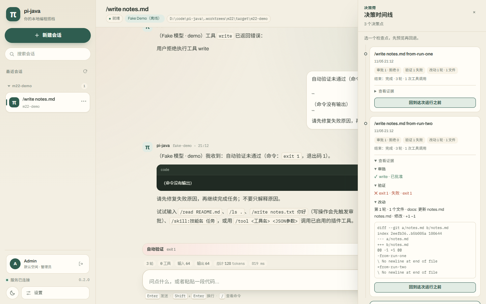
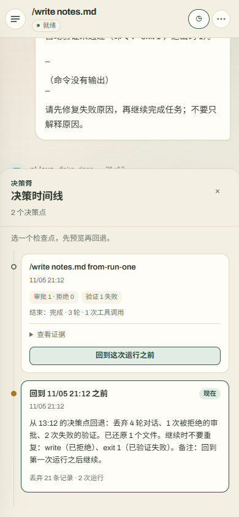
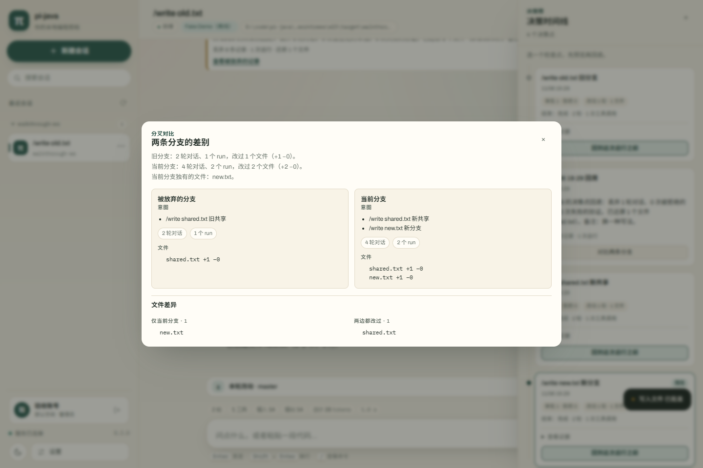
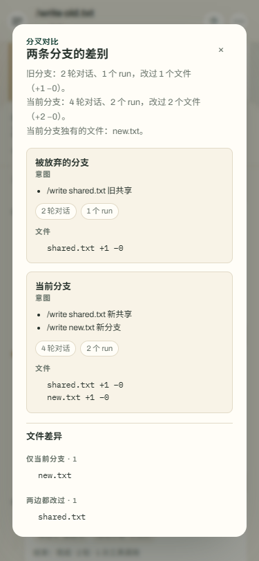

# 11 界面设计

> 状态：2026-10-24 完成第二轮重设计，2026-10-25 增加本轮改动面板。
> Web 与终端共用“纸面 + 苔绿”的视觉语言。
> 目标是让第一次使用的人不用读文档就知道从哪里开始、工具要做什么、怎么拒绝。

## 1. 设计目标

- **一眼看懂**：首屏只有一句话、两个可点的示例和一个输入框，不堆功能。
- **一步开始**：示例卡片直接发送消息，不需要先学斜杠命令。
- **随时可退**：写操作默认弹审批；拒绝是安全默认，弹窗焦点落在“先不要”。
- **离线也好看**：不依赖网络字体与图标库，深浅色都按本地字体调过对比度。

## 2. 调研结论

参考了 AI 产品空状态与本地工具的常见做法，保留三条：

1. 空状态要给“做过的事”而不是功能清单：示例卡片带真实提示词与预期结果；
2. 主操作要唯一：新建会话、发送、允许执行各自只有一个视觉重点；
3. 过程要可折叠：思考与工具轨迹默认收起，需要时再展开，避免淹没回答。

## 3. 视觉系统

| 令牌 | 浅色 | 深色 | 用途 |
|---|---|---|---|
| `--canvas` | `#f3efe3` | `#121613` | 页面底色 |
| `--surface` | `#fffdf7` | `#1c231e` | 卡片、弹窗、输入框 |
| `--surface-soft` | `#f8f3e7` | `#222a24` | 次级面板 |
| `--ink` | `#26312b` | `#eef1e6` | 标题 |
| `--text` | `#2b352e` | `#dfe4d8` | 正文 |
| `--muted` | `#68736a` | `#98a394` | 辅助信息 |
| `--accent` | `#2f5d50` | `#9cc8ae` | 主操作、当前会话、助手标记 |
| `--apricot` | `#b96845` | `#e9a687` | 提醒与高风险 |
| `--amber` | `#a97a25` | `#d7b46a` | 等待审批、压缩 |
| `--code-bg` | `#202a23` | `#0d110e` | 代码块与参数预览 |

- 圆角分四档：8 / 12 / 16 / 22 / 28px；按钮统一胶囊形，输入框 22px。
- 阴影只用于浮层与输入区，正文靠留白和 1px 暖灰描边分层。
- 背景叠加两层径向渐变和一层很淡的 SVG 噪点，避免大面积纯色的“模板感”。
- 内置字体栈：正文用系统中文黑体，代码与数字用等宽栈，离线可用。

## 4. Web 结构

- **侧栏**：品牌、新建会话、搜索、会话列表、服务状态、主题切换、设置。
  会话项只显示标题与工作目录；运行中、等待审批、已归档才显示状态文字。
  列表按工作目录分组，组头显示目录名与数量、可折叠并记忆；每行右侧 `⋯`
  菜单提供重命名与删除；搜索时自动展开匹配分组。
- **顶栏**：会话标题、状态与模型、工作目录、上下文用量、手动压缩、会话设置。
- **对话区**：用户消息靠右、助手消息靠左；执行过程折叠为一条摘要，支持展开。
  工具改变工作区后，输入框上方出现“本轮改动”面板：摘要行显示分支、文件数与
  行数，展开后是逐轮文件列表、提交建议与着色 diff；撤销按钮在摘要行右侧。
- **输入区**：斜杠命令菜单向上展开；Enter 发送，Shift+Enter 换行。
  运行中发送的消息排队，输入框上方显示队列提示与取消。
  输入框左侧的图片按钮、粘贴与拖放都能添加图片，缩略图排在输入框上方，
  点 × 移除；上传中发送按钮禁用，模型不支持视觉时按钮直接提示原因。
- **决策脊与时间线面板**：聊天区右侧固定一条窄刻度条（决策脊），每个运行一个
  刻度，当前刻度高亮；点击刻度或顶栏“时间线”打开右侧固定面板（窄屏隐藏刻度条，
  面板改为底部抽屉）。每个运行一条节点，节点之间用竖线连接；当前节点高亮，已回溯
  的节点显示为“回溯”节点。节点默认只显示意图、状态与改动摘要，展开后显示计划、
  审批、验证、逐轮文件与 diff。每个可回溯节点有“回到这次运行之前”，点击后先出现
  预览对话框（原生 `<dialog>`），列出将还原的文件、将丢弃的对话数量与回溯简报；
  确认按钮在预览加载完成前禁用。回退后聊天区保留回退点之前的对话，并追加一张回溯
  简报卡片；简报列出还原的文件名，并提供“查看被放弃的记录”。该弹窗只展示回退点
  之后被放弃的片段，不重复聊天区已有内容；片段里若还包含更早的回溯简报，可以继续
  点开，并用“返回上一段”回到上一层。回退节点另有“对比两条分支”，打开只读对比
  对话框：顶部一句话摘要，下面“旧分支 / 当前分支”两列统计与意图，底部按
  “仅旧分支 / 仅新分支 / 两边都改过”列出文件差异；桌面双列，窄屏上下堆叠。

交互细节：

| 场景 | 行为 |
|---|---|
| 搜索会话 | 输入即过滤标题、目录与状态；Esc 清空；搜索期间强制展开分组 |
| 分组折叠 | 组头点击切换，状态写入 `localStorage`，刷新后保持 |
| 重命名/删除 | 行内 `⋯` 菜单；重命名用轻量对话框，删除二次确认；运行中的会话禁止删除 |
| 运行中切换会话 | 断开前端事件流但不打断服务端 run；再次打开自动重连 |
| 运行中发送 | 进入当前会话队列，本轮结束后按顺序自动发出 |
| 图片输入 | 选择/粘贴/拖放添加；本地预览先出现，上传完成后换成服务端地址；最多 4 张，单张 5 MB |
| 图片压缩 | 超过 1.5 MB 的非 GIF 在浏览器缩放到最长边 1568 px、转 WebP 0.85；卡片显示“已优化”与压缩后大小，悬停可看原图大小 |
| 图片历史 | 用户消息中的图片按原比例显示，窄屏不溢出；点击在新标签打开原图 |
| 附件存储 | 设置 → 系统信息展示已保存数量、占用与配额；清理按钮只删除无会话引用且超过宽限期的附件 |
| 主题 | 首次跟随系统，手动切换后写入 `localStorage` |
| 窄屏 | 侧栏变成抽屉，遮罩点击或 Esc 关闭；`Ctrl/Cmd+K` 聚焦搜索 |
| 长会话 | 离开底部时出现回到底部按钮 |
| 复制回答 | 悬停助手消息显示“复制”，失败时回退到选区复制 |
| 审批 | 纯中文风险标签、参数预览、倒计时、意见输入；允许与拒绝权重明确 |
| 本轮改动 | 摘要行可直接撤销；展开后按轮展示文件与 diff；无改动时不占空间 |
| 撤销冲突 | 面板展开并列出被后续修改的文件与原因，不静默失败 |
| 时间线打开 | 右侧滑出，遮罩点击或 Esc 关闭；保持面板滚动位置 |
| 回溯预览 | 默认 dry-run，不写文件；取消不发第二次请求 |
| 回溯冲突 | 预览显示冲突文件与原因，确认按钮禁用，不提供强制覆盖 |
| 分叉对比 | 回退节点上的只读对话框；加载中显示“正在读取两条分支…”，失败在框内提示，不写数据 |
| 对比无回退 | 对话框直接说明“这个会话还没有回退”，不展示空的两列 |
| 空目录变化 | 新增文件删除后空目录可能保留，文案不承诺“完全恢复目录结构” |

## 5. 审批弹窗

- 标题直接说“这里需要你确认一下”，副标题说明工具会做什么。
- 风险等级从 `HIGH` 映射为“高风险”，并在悬停时解释评估来源。
- 参数区域标注“参数已脱敏”，键名包含 key/token/secret 的值显示为 `***`。
- 技术摘要（SHA-256）默认折叠，普通用户不必理解。
- 打开时焦点在“先不要”，避免回车误批准；拒绝可附一句原因。

## 6. 终端界面

- 颜色：苔绿提示符与成功、琥珀工具过程、红色失败；`NO_COLOR` 时全部退化为纯文本。
- 头部：品牌行、细分隔线、一句能力说明、工作目录与会话 ID。
- 输入区：圆角 `╭╮╰╯` 盒子，标签“想做什么？”，提示符 `│›`。
- 审批：圆角面板展示工具与中文风险，`y`/`yes`/`是`/`好` 批准，回车拒绝。
- 改动：工具改变工作区后打印一行 `± 改动 N 个文件 +X -Y`；`/diff` 查看文件与
  至多 120 行 diff，`/undo` 撤销上一轮，冲突逐条列出。
- 行模式（非 TTY）保留同样的中文风险标签与“它准备这样做”提示，去掉颜色与边框，适合管道与脚本。

## 7. 可访问性

- 所有可交互元素有 `:focus-visible` 焦点环；弹窗使用原生 `<dialog>`。
- 主题切换、抽屉按钮维护 `aria-expanded` 与 `aria-label`。
- 尊重 `prefers-reduced-motion`，关闭动画与过渡。
- 文本对比度按 WCAG AA 调整；正文不小于 14px，辅助信息不小于 12px。

## 8. 验证

- 浏览器走查：970×833 桌面浅色/深色、390px 抽屉与弹窗、审批允许/拒绝、复制与搜索。
  2026-10-25 追加 1440×900 与 390px 的改动面板：折叠/展开、diff 横向滚动、
  撤销确认与冲突展示，控制台无错误；截图见 `docs/images/changes.png`。
- 2026-10-27 追加附件走查（独立 18081 实例）：10.3 MB PNG 显示为
  `982 KB · 已优化`，悬停提示原图大小；设置页存储卡片展示 2 张/2.0 MB/512 MB，
  清理后孤儿附件消失、已引用图片保留；截图见
  `docs/images/attachments-compressed.png` 与 `docs/images/settings-storage.png`。
- 终端走查：管道模式跑通 `/write` 审批拒绝流程，确认中文风险标签与提示文案。
- 2026-11-05 追加 M22 时间线走查（独立 8081 实例，Fake 模型 + 临时 Git 仓库 +
  `PI_VERIFY_COMMAND="exit 1"`）：两次 `/write` 加一次拒绝审批共三个节点，右侧决策脊
  出现三个刻度且点击可定位节点；展开证据可见拒绝与失败标记及 diff；在第二个节点
  预览并确认回溯后，文件恢复且会话出现“回溯简报”卡片；390px 下刻度条隐藏、面板为
  底部抽屉，Esc 可关闭；控制台无错误。

  

  
- 2026-11-05 追加回退历史走查（独立 8081 实例）：三轮 `/write` 审批通过后连续回退两次。
  第一次回退只放弃第三轮，弹窗不重复前两轮；第二次回退的片段包含第一次的回溯简报，
  点开后能看到第三轮，并用“返回上一段”回到第二轮的片段；回退点之前的记录始终留在
  聊天区，控制台无错误。
- 2026-11-06 追加 M23 分叉对比走查（独立 8093 实例，Fake 模型 + 临时 Git 仓库）：
  两次 `/write` 后回退，再继续两轮 `/write`，在时间线的回退节点打开“对比两条分支”；
  对话框显示旧分支/当前分支统计、意图与文件差异，1440×960 为双列、375×812 上下堆叠，
  无横向溢出；控制台无错误，对比请求无 4xx。

  

  
- 自动化：`AnsiTest` 覆盖品牌色与宽度；`TuiRendererTest` 覆盖流式输出与工具摘要；
  `TuiApprovalTest` 覆盖审批面板文案、按键与中断处理。
- 本机自动化环境没有真实 TTY，交互式 TUI 的圆角组合与流式刷新由单元测试保证，
  未做终端录屏；建议在本机终端里执行 `pi chat` 目测一次。
- 截图见 [README](../README.md) 与 `docs/images/`。
